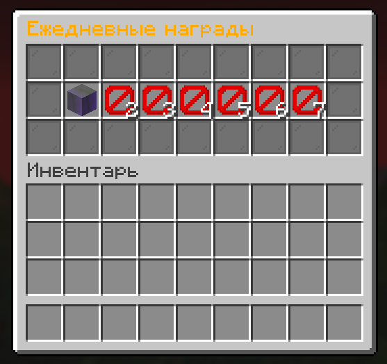
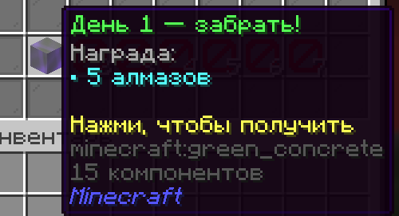
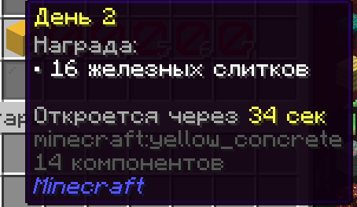
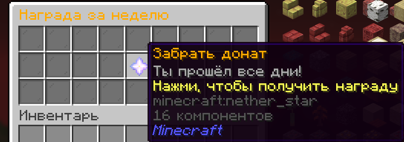

# 🎁 DailyRewards

Плагин ежедневных наград для Minecraft-серверов на **Paper**.
Игрок заходит каждый день, открывает `/daily` и забирает награду. Пропустил день — серия начинается заново. Прошёл все дни — получает бонус.



## ✨ Возможности

- Красивое меню с наградами за каждый день
- Таймер до следующей награды обновляется в меню каждую секунду
- Сброс серии, если игрок пропустил день
- Бонус за прохождение всех дней (например, донат-привилегия)
- Любое количество дней и любые награды: предметы и команды
- **Все тексты** настраиваются в `messages.yml`
- Поддержка HEX-цветов (`&#FF8800`)
- Звуки, title на экране, свечение предметов
- Напоминание при входе на сервер, если награда доступна
- Админ-команды с подсказками по Tab

## 📋 Требования

- Paper **26.3**
- Java **25**

## 📥 Установка

1. Скачай `DailyRewards.jar`
2. Положи его в папку `plugins` на сервере
3. Перезапусти сервер
4. Настрой `config.yml` и `messages.yml` в папке `plugins/DailyRewards`
5. Примени изменения командой `/daily reload`

## 💬 Команды

| Команда | Описание | Право |
| --- | --- | --- |
| `/daily` | Открыть меню наград | `daily.use` |
| `/daily reload` | Перезагрузить конфиг и сообщения | `daily.admin` |
| `/daily reset <ник>` | Сбросить прогресс игрока | `daily.admin` |
| `/daily setday <ник> <день>` | Установить игроку день | `daily.admin` |

Псевдонимы: `/reward`, `/rewards`

## 🔐 Права

| Право | Описание | По умолчанию |
| --- | --- | --- |
| `daily.use` | Открывать меню `/daily` | Все игроки |
| `daily.admin` | Админ-команды | Операторы |

## ⚙️ Настройка

### Награды за дни (`config.yml`)

```yaml
days:
  1:
    items: ["DIAMOND:5"]
    commands: []
    display: ["&b• 5 алмазов"]
```

- `items` — предметы в формате `МАТЕРИАЛ:КОЛИЧЕСТВО`
- `commands` — команды от консоли
- `display` — как награда выглядит в описании предмета

### Бонус за прохождение

```yaml
completion:
  commands:
    - "lp user %player% parent addtemp vip 7d"
```

### Основные настройки

| Настройка | Описание |
| --- | --- |
| `cooldown-hours` | Через сколько часов открывается следующий день |
| `reset-enabled` | Сбрасывать ли серию за пропуск |
| `reset-after-hours` | Сколько часов даётся, чтобы забрать день |
| `restart-after-finish` | Начинать ли неделю заново после бонуса |
| `full-inventory-drop` | Выкидывать награду на землю, если инвентарь полный |

## 🏷️ Плейсхолдеры

| Плейсхолдер | Значение |
| --- | --- |
| `%prefix%` | Префикс из `messages.yml` |
| `%player%` | Ник игрока |
| `%day%` | Номер дня |
| `%time%` | Время до следующей награды |
| `%rewards%` | Список наград из `display` |
| `%h%`, `%m%`, `%s%` | Часы, минуты, секунды (в формате времени) |

## 📸 Скриншоты





## 👤 Автор

**playerp6** — пишу и настраиваю плагины для Minecraft-серверов.
Нужен плагин под свой сервер? Пиши: *t.me/PlayerP666*